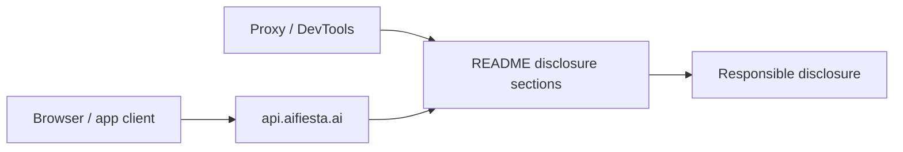

# Hacked-AiFiesta — architecture

## Purpose

Documentation-only disclosure repository for AiFiesta (`aifiesta.ai`) client and API security findings. There is no runtime service — the system is the **structured report** (`README.md`) plus supporting proof snippets. Inputs are observed HTTP traffic and client behavior; outputs are severity-ranked vulnerabilities, reproduction steps, and remediation guidance for the vendor.

## High-level flow

## Module map

| Path | Responsibility |
| --- | --- |
| `README.md` | Executive summary, vulnerability catalog, PoC curls, impact table |
| `LICENSE` / `NOTICE` | HackerX License and attribution |
| `SECURITY.md` | Reporting and authorized-use policy |
| `.github/workflows/ci.yml` | Org standards verification (LICENSE, NOTICE, ARCHITECTURE, README) |

## Extension

1. Add new findings as numbered sections in `README.md` (severity, impact, reproduction, fix).
2. Keep PoCs as minimal curl or request examples — no live exploit automation in-repo.
3. Update the impact table when severity or business risk changes.

## Testing strategy

- **CI**: File presence checks for org artifacts only.
- **Manual**: Re-validate PoCs only on systems you are authorized to test.

## Ethics & scope

Authorized security research and vendor disclosure only. See [SECURITY.md](./SECURITY.md).
